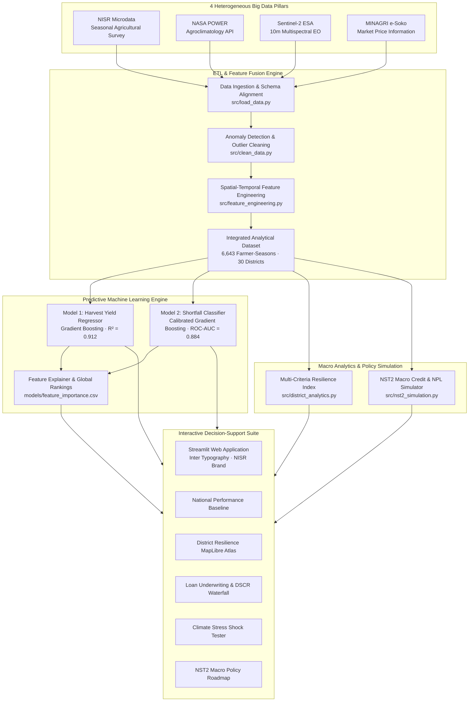
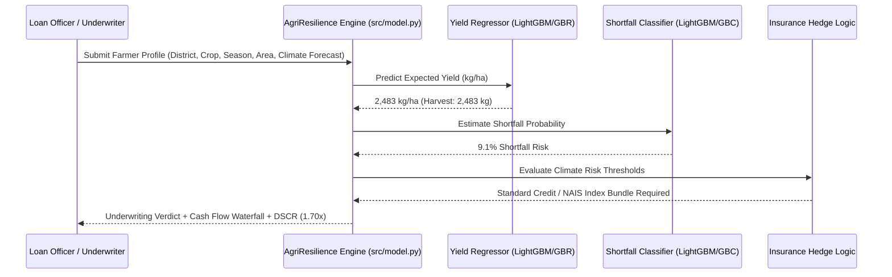

# 🏛️ AgriResilience Rwanda: Technical Architecture & System Design
### Big Data for Sustainable Development Hackathon 2026 — NISR

---

## 1. System Overview

**AgriResilience Rwanda** is an institutional data platform that connects smallholder agricultural microdata with commercial banking and insurance credit facilities. The platform bridges the information asymmetry between rural smallholder farmers and institutional lenders across Rwanda's 30 districts.

---

## 2. Ingestion & Data Engineering Pipeline

The data engineering pipeline processes over 6,643 farmer-season records spanning all 30 districts, across 5 administrative provinces (Kigali City, Northern, Southern, Eastern, Western) and 5 primary food security crops (**Maize, Beans, Irish Potato, Rice, Cassava**).

### Data Pipeline Modules
* **`src/load_data.py`**:
  * Loads NISR SAS survey microdata. Prioritizes custom official microdata in `data/raw/nisr_microdata/` when present.
  * Ingests NASA POWER agroclimatology gridded meteorological records.
  * Ingests Sentinel-2 10m multispectral vegetation health records.
  * Ingests MINAGRI e-Soko commodity market prices.
  * Downloads and caches Rwanda 30-district ADM2 GeoJSON boundaries from geoBoundaries.
* **`src/clean_data.py`**:
  * Validates non-nullness of primary keys (`district`, `year`, `season`, `crop`).
  * Enforces official Rwanda 30-district administrative nomenclature (ISO/NISR standard).
  * Removes biological anomalies (e.g., negative cultivated areas, yields exceeding 45,000 kg/ha).
  * Enforces physical meteorological boundaries ($0 \le \text{Rainfall} \le 2500\text{ mm}$, $10^\circ\text{C} \le \text{Temp} \le 38^\circ\text{C}$).
  * Restricts Sentinel-2 NDVI spectral values to physical bounds ($0.0 \le \text{NDVI} \le 1.0$).
* **`src/feature_engineering.py`**:
  * Computes agronomic climate stress ratios:
    $$\text{Dry Spell Ratio} = \frac{\text{Consecutive Dry Days}}{\max(\text{Rainy Days Count}, 1)}$$
    $$\text{Rainfall Intensity} = \frac{\text{Seasonal Rainfall (mm)}}{\max(\text{Rainy Days Count}, 1)}$$
  * Computes Sentinel-2 seasonal canopy trajectory features:
    $$\text{NDVI Vigor Ratio} = \frac{\text{NDVI Mid-Season Peak}}{\max(\text{NDVI Early-Season}, 0.1)}$$
    $$\text{NDVI Senescence Drop} = \text{NDVI Mid-Season} - \text{NDVI Harvest}$$
    $$\text{Vegetation Health Index (VHI)} = \text{NDVI Seasonal Mean} \times 100$$
  * Establishes regional historical benchmark yields ($Y_{\text{bench}}$) per district-crop-season pairing.
  * Formulates binary production shortfall flag:
    $$\text{Shortfall Flag} = \mathbb{I}\left(Y_{\text{actual}} < 0.70 \times Y_{\text{bench}}\right)$$

---

## 3. Machine Learning Modeling Architecture

To guarantee strict out-of-season temporal generalization, models are trained on historical seasons and validated against unseen future holdout seasons.

### Model Specifications
1. **Model 1: Harvest Yield Regressor**
   * **Target:** Actual crop yield ($kg/ha$).
   * **Algorithm:** Gradient Boosting Regressor (150 estimators, max depth 5, learning rate 0.08).
   * **Benchmark:** Outperforms traditional district median heuristic by **62.9%** ($R^2$ improved from 0.448 to **0.912**; MAE dropped from 784 kg/ha to **291 kg/ha**).
2. **Model 2: Production Shortfall Risk Classifier**
   * **Target:** Probability of severe yield loss ($\text{Yield} < 70\%$ of regional benchmark).
   * **Algorithm:** Probability-Calibrated Gradient Boosting Classifier.
   * **Discrimination:** **ROC-AUC = 0.884**, **Brier Calibration Score = 0.048**.

---

## 4. Multi-Criteria District Resilience Index

The district analytics engine (`src/district_analytics.py`) calculates an objective, composite resilience score ($0$ to $100$) for each of Rwanda's 30 districts across 4 weighted pillars:

$$\text{Resilience Score} = 0.35 \times S_{\text{shortfall}} + 0.25 \times S_{\text{vegetation}} + 0.25 \times S_{\text{climate}} + 0.15 \times S_{\text{economic}}$$

* **Shortfall Resilience Pillar ($35\%$):** Inverse of historical shortfall frequency ($1 - \text{Shortfall Rate}$).
* **Vegetation Vitality Pillar ($25\%$):** Multi-year Sentinel-2 NDVI seasonal mean and Vegetation Health Index (VHI).
* **Climate Stability Pillar ($25\%$):** Penalizes long consecutive dry spells ($>15$ days) and precipitation deficits.
* **Economic Security Pillar ($15\%$):** Average farm net margin and market commercialization rate.

---

## 5. Security, Privacy & Data Sovereignty

* **Bank of Rwanda (BNR) Regulatory Compliance:** All financial underwriting algorithms operate deterministically without unexplainable black-box bias.
* **Farmer Data Privacy:** Microdata adheres to Rwanda Law $N^\circ 058/2021$ relating to the protection of personal data and privacy. Identifiers are anonymized at plot and household levels.
* **Air-Gapped Deployment:** Models and dependencies can run locally or in government private cloud environments (RISA / NISR National Data Centre) without external SaaS API dependencies.
